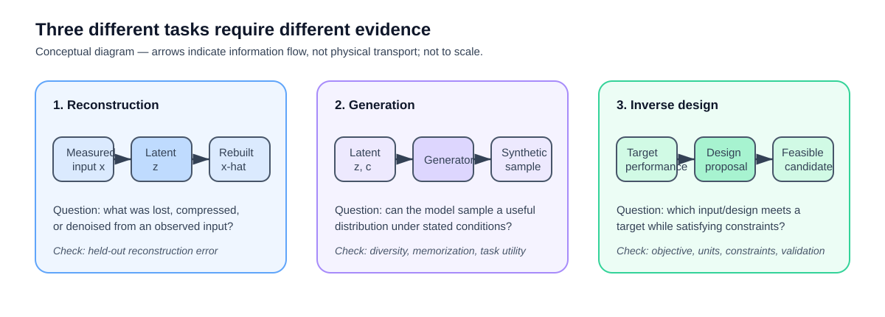
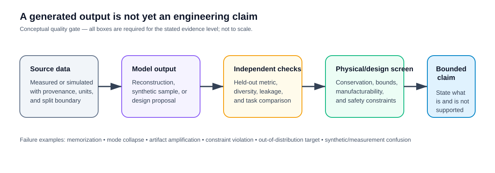

# VI. Generative Models and Inverse Engineering Design

> **Status: under development.** This folder separates generative modeling from reinforcement learning, but it is not yet a complete, assignable module.

**Five-minute demo:** Run [`generative_design_screen.py`](../short_code_demos/generative_design_screen.py) to screen reported design candidates against mass and temperature constraints. This is deliberately a feasibility check, not a generative model or a validated inverse-design workflow.

**Detailed foundations:** Read [generative-model and inverse-design foundations](FOUNDATIONS.md) for the reconstruction, generation, and constrained-design formulations; an evidence ladder; and failure checks. This does not change the module's under-development status.

## Engineering question

When can a generative model create, reconstruct, enhance, augment, or propose engineering designs without corrupting the physical interpretation, uncertainty, manufacturability, or decision process?

## Intended scope

The module will introduce generative adversarial networks (GANs), autoencoders, diffusion-style concepts, and constrained inverse-design ideas through an engineering-data use case such as microscopy, thermal imagery, flow visualization, sensor signals, or design variables. It will distinguish synthetic-data generation from measurement, interpolation from extrapolation, visually plausible output from physically credible output, and an unconstrained candidate from a manufacturable design.

For GANs, the core adversarial objective is:

$$
L_D = \mathrm{CE}(1, D(x_{\mathrm{real}})) + \mathrm{CE}(0, D(x_{\mathrm{fake}})),
\qquad
L_G = \mathrm{CE}(1, D(x_{\mathrm{fake}})).
$$

These losses alone do not establish physical validity, distributional coverage, or usefulness for an engineering task.

## Visual guide

*Figure 1. Conceptual task map. The arrows show information flow, not a measured physical process. The task must be named before choosing an evaluation method.*

*Figure 2. Conceptual evidence pathway. A generated output remains a candidate until provenance, independent evaluation, and relevant physical/design constraints support a bounded claim.*

## Requirements before classroom assignment

- a redistributable engineering dataset with a data card, split rules, and units/metadata where applicable;
- a local reproducible tutorial rather than only an external notebook link;
- an explicit non-generative baseline;
- evaluation beyond visual inspection, including a held-out condition and a task-relevant metric;
- a failure audit for artifacts, mode collapse, memorization, distribution shift, or physically implausible samples;
- an explicit design-constraint and feasibility check for any inverse-design activity; and
- an AI-use and provenance requirement that labels all synthetic outputs as synthetic.

Until these are complete, instructors should not present this folder as a ready homework option.

The [credibility protocol](CREDIBILITY_PROTOCOL.md) turns these requirements into a release gate for a future tutorial and assignment. It does not change the module's under-development status.
